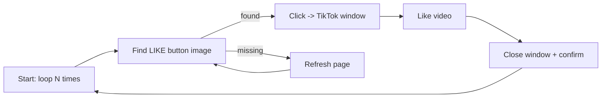

# Like4Like TikTok Credit Farming

  [](https://github.com/panhavad/like4like-tiktok-credit-farming/releases/latest)

A **SikuliX (image recognition) automation script** that loops through Like4Like TikTok tasks, opens each video, likes it and confirms - running inside a browser-accessible **Ubuntu desktop container**. Built as an automation / computer-vision experiment.


## Features

- Screen image matching with SikuliX patterns
- Configurable loop count with cancel popup
- Auto refresh when buttons are not found
- Dockerized Ubuntu LXDE desktop over noVNC

## How it works



## Getting started

```bash
docker compose up -d      # desktop at http://localhost:6080
apt install default-jre
wget https://launchpad.net/sikuli/sikulix/2.0.5/+download/sikulixide-2.0.5.jar
java -jar sikulixide-2.0.5.jar   # open o.py and run
```

## Download

Grab the packaged source from the [latest release](https://github.com/panhavad/like4like-tiktok-credit-farming/releases/latest).

## Tech stack

- SikuliX (Jython)
- Docker
- Ubuntu LXDE + noVNC

## Project structure

```text
like4like-tiktok-credit-farming/
├── docs/
├── CONFIRMBTN.png
├── docker-compose.yml
├── LIKE4LIKE.png
├── LIKEONTENTBTN.png
├── LOGO.png
├── o.py
└── README.md
```

## Original notes

```
apt install default-jre
wget https://launchpad.net/sikuli/sikulix/2.0.5/+download/sikulixide-2.0.5.jar
```
